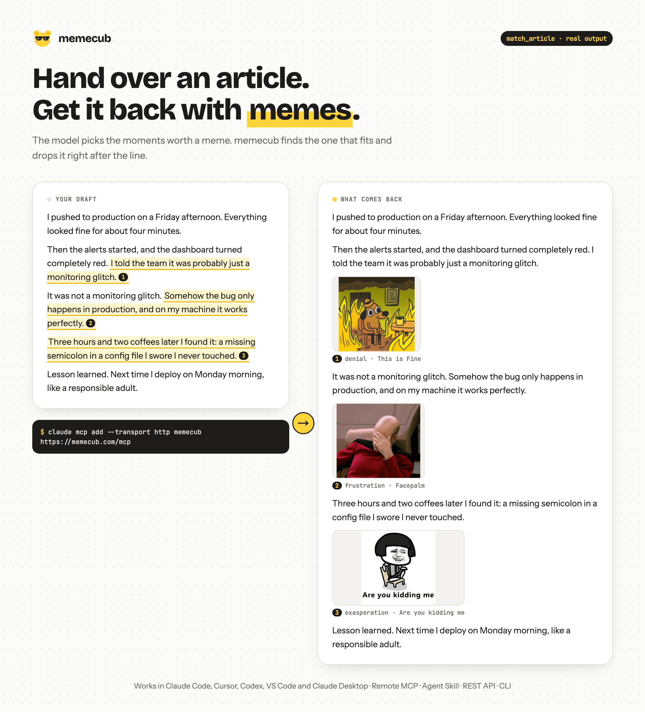
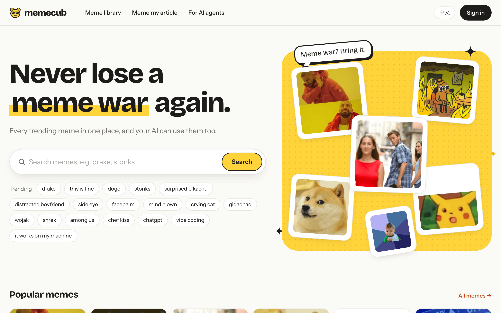
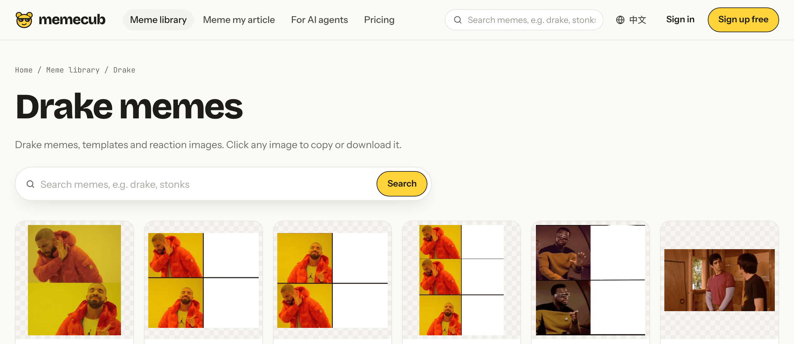
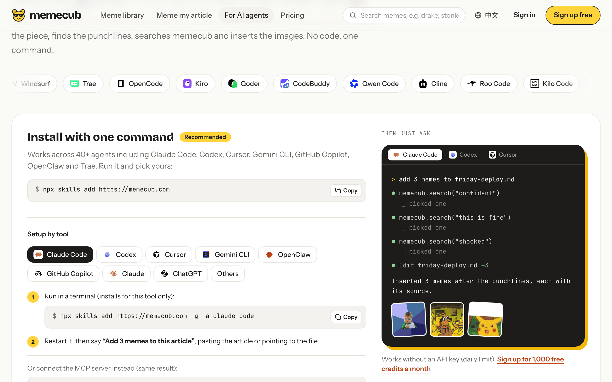

<div align="center">


# memecub

**Meme search and automatic meme placement for AI agents.**

Give Claude Code, Cursor, Codex or Claude Desktop a meme library. Search reaction memes by feeling, or hand over an article and get it back with the right meme after the right sentence.

English · [简体中文](README.zh-CN.md)

[](https://memecub.com)
[](https://registry.modelcontextprotocol.io/v0/servers?search=com.memecub/memecub)
[](https://smithery.ai/servers/memecub/memecub)
[](#quick-start)
[](https://www.npmjs.com/package/memecub)
[](LICENSE)

</div>



<p align="center"><sub>Real output of <code>match_article</code>. The model picks the moments; memecub finds the meme and inserts it as Markdown.</sub></p>

## Why memecub

- **It places memes, not just finds them.** `match_article` reads a whole post, picks the sentences worth a meme and returns the article with images inserted. Your agent doesn't have to guess where they go.
- **Search by feeling.** Ask for `facepalm`, `this is fine`, `it works on my machine`, `无语` or `摸鱼` and get the reaction you meant, not a keyword lookalike.
- **English memes and Chinese 表情包 in one library.** Drake, This Is Fine, Doge and Surprised Pikachu next to 熊猫头, 奶龙, 蘑菇头, 金馆长 and DeepSeek 鲸鱼娘. Chinese queries match whole phrases, so a character name returns that character.
- **Zero install.** A remote MCP server over Streamable HTTP, or a plain-curl Agent Skill. Searching works without a key.
- **License-aware results.** Every image says whether it is cleared for commercial use, links its source, and ships a ready Markdown snippet with the credit line when one is required. Ask for commercial-safe only and that's all you get.
- **Safe defaults for agents.** Memes whose captions contain swearing are left out of agent results unless you ask for them.

## Quick start

The server is `https://memecub.com/mcp`. Pick your client:

**Claude Code**

```bash
claude mcp add --transport http memecub https://memecub.com/mcp
```

**Cursor** (`~/.cursor/mcp.json`)

```json
{ "mcpServers": { "memecub": { "url": "https://memecub.com/mcp" } } }
```

**VS Code** (`.vscode/mcp.json`)

```json
{ "servers": { "memecub": { "type": "http", "url": "https://memecub.com/mcp" } } }
```

**Claude Desktop / claude.ai**: Settings → Connectors → Add custom connector → `https://memecub.com/mcp`

**Codex** and any agent that reads skills: use the [Agent Skill](#agent-skill) below.

Then just ask:

> Add 3 memes to draft.md where they fit.
>
> Find me a facepalm meme, commercial use only.
>
> 给这篇文章配几张表情包。

## MCP tools

| Tool | What it does |
|---|---|
| `search_memes` | Search by reaction, feeling or character. Filters: `commercial_only`, `no_credit`, `kind` (meme, gif, emoji, artwork, photo), `min_size` |
| `match_article` | Read an article, pick the spots that deserve a meme, return the article with images inserted (needs a key) |
| `get_meme` | Full details for one image: license, source, author, credit line, tags |
| `list_categories` | Library categories |

Searching needs no key. Add `Authorization: Bearer <key>` (free, create one at [memecub.com/library](https://memecub.com/library#keys)) for higher daily limits, your private library and `match_article`.

## Agent skill

[`skills/memecub/SKILL.md`](skills/memecub/SKILL.md) teaches an agent to place memes into writing with plain `curl`. No MCP, no dependencies, works in Claude Code, Codex and Cursor.

```bash
npx skills add liyupi/memecub
```

Or by hand:

```bash
# Claude Code: ~/.claude/skills   Codex: ~/.codex/skills   Cursor: ~/.cursor/skills
mkdir -p ~/.claude/skills/memecub
curl -s https://memecub.com/skill.md -o ~/.claude/skills/memecub/SKILL.md
```

## REST API

```bash
curl -sG https://memecub.com/api/v1/search --data-urlencode "q=facepalm" -d limit=1
```

```jsonc
{
  "data": [{
    "title": "Facepalm",
    "url": "https://gpic.code-nav.cn/memecub/public/12vw20qg0awo.jpg",
    "page_url": "https://memecub.com/meme/12vw20qg0awo-facepalm",
    "width": 679, "height": 600, "kind": "meme",
    "license": { "code": "web", "commercial_use": false, "attribution_required": false },
    "markdown": ""
  }]
}
```

All endpoints and limits: [memecub.com/developers](https://memecub.com/developers).

## CLI and JS client

[`memecub` on npm](https://www.npmjs.com/package/memecub), source in [`cli/`](cli). Node 18+.

```bash
npx memecub search "facepalm" --limit 5
npm i -g memecub                                  # or install the `memecub` command
memecub search "facepalm" --limit 5
memecub search "mind blown" --commercial          # only images cleared for commercial use
memecub match ./article.md --count 4 > article.with-memes.md
```

```ts
import { MemecubClient } from "memecub";

const client = new MemecubClient("https://memecub.com", process.env.MEMECUB_API_KEY);
const { data } = await client.search({ q: "mind blown", limit: 5, commercialOnly: true });
```

## The website

Everything the agent sees is also browsable at [memecub.com](https://memecub.com): search, topic pages, one-click copy and download, and the article tool in the browser.

| Home | Topic page | Agent setup |
|---|---|---|
| [](https://memecub.com) | [](https://memecub.com/tag/drake) | [](https://memecub.com/developers) |

## FAQ

**Is it free?** Yes. Without a key you can search; a free key raises the daily limits and unlocks `match_article`.

**Can I use the images commercially?** Check `license.commercial_use` on each result. Memes collected from the web are `false`: copyright belongs to their creators and the source link is kept. Openly licensed images (CC0, public domain, CC BY and similar) are `true` and come with the credit line when the license needs one. Pass `commercial_only: true` (MCP) or `commercial=1` (REST) to get only those.

**Is the website open source?** No. This repository holds the integrations (MCP descriptor, Agent Skill, CLI and client). The site and its data pipeline are run by memecub.

**Found a problem with an image?** Use the report button on its page, or see [memecub.com/dmca](https://memecub.com/dmca).

## License

Code in this repository is [MIT](LICENSE). Images are not covered by MIT; each result carries its own license.

If memecub saves your agent a trip to the image search, a ⭐ helps others find it.
