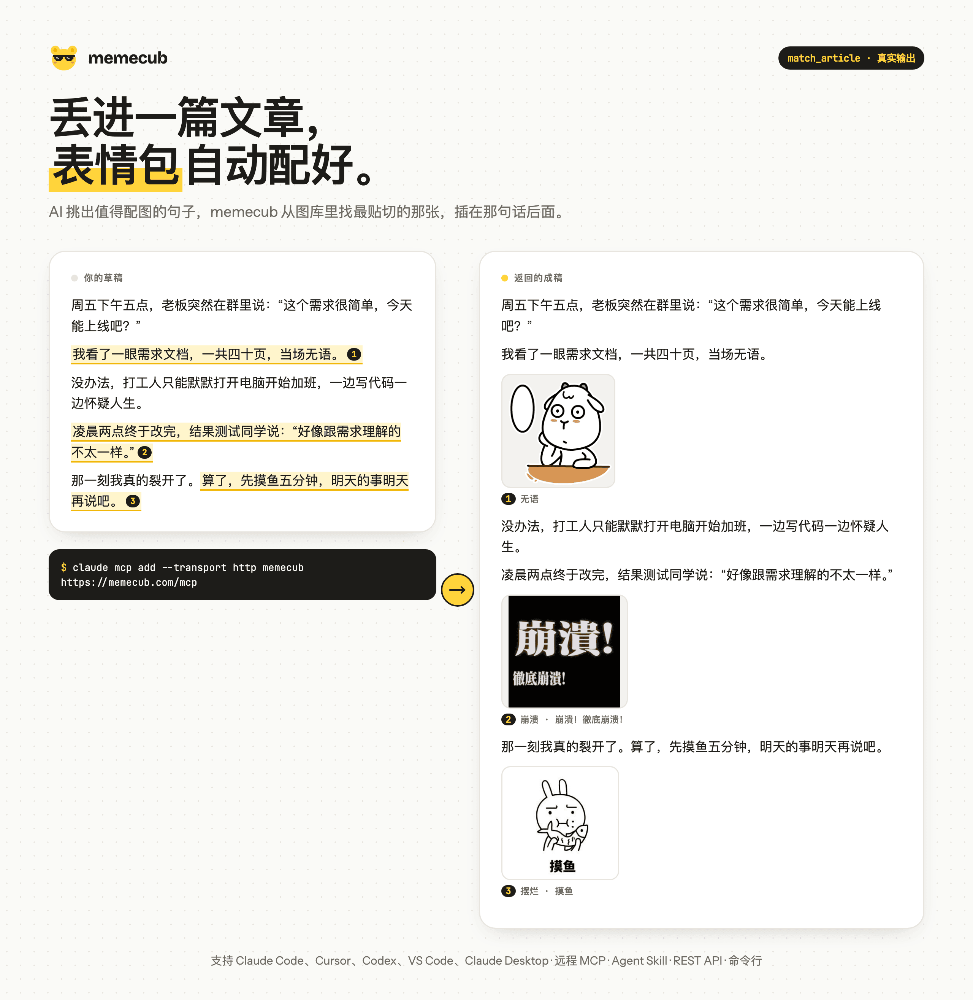
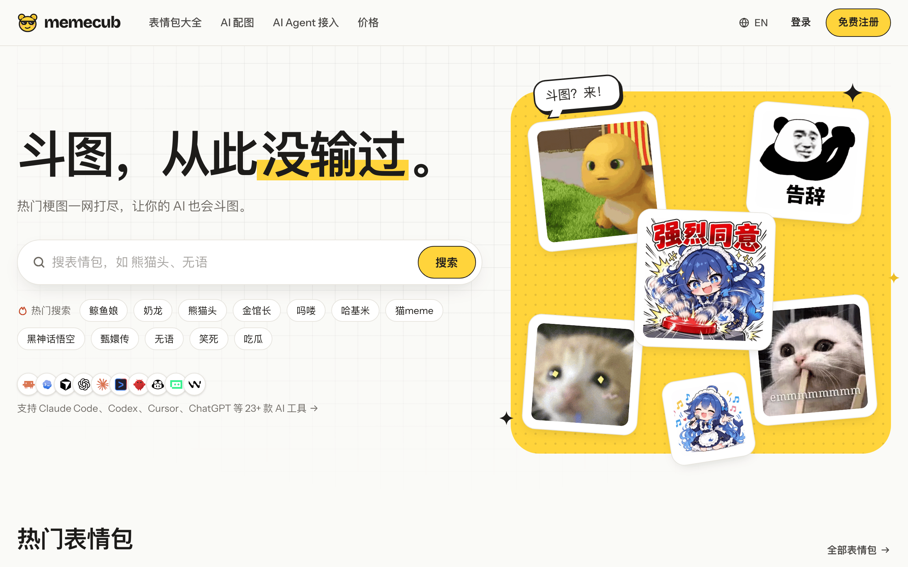
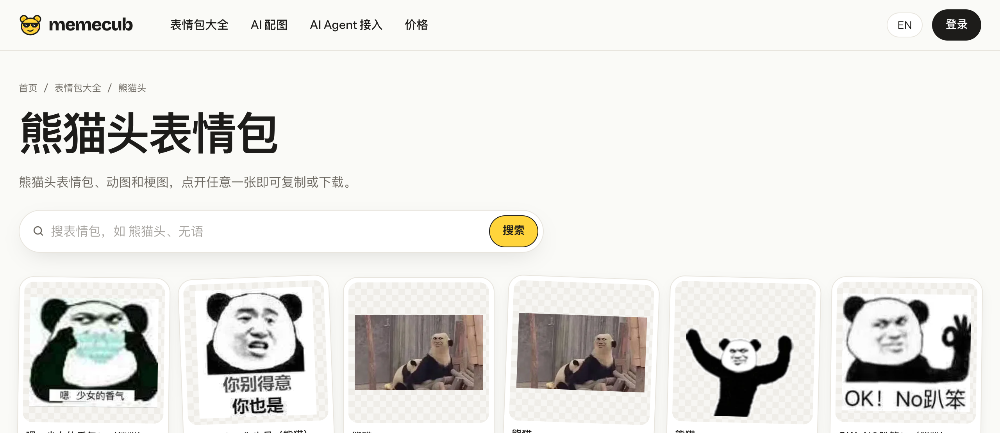
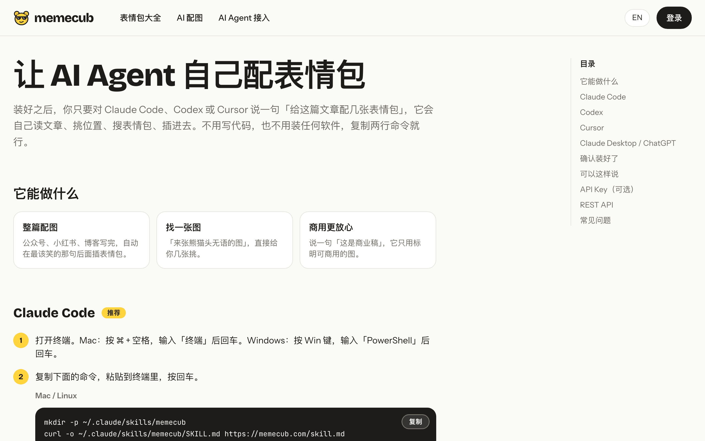

<div align="center">


# memecub

**给 AI Agent 用的表情包搜索和自动配图工具。**

让 Claude Code、Cursor、Codex、Claude Desktop 拥有一个表情包图库：按情绪搜梗图，或者把整篇文章丢给它，返回在合适的句子后面配好表情包的成稿。

[English](README.md) · 简体中文

[](https://memecub.com/zh)
[](https://registry.modelcontextprotocol.io/v0/servers?search=com.memecub/memecub)
[](https://smithery.ai/servers/memecub/memecub)
[](#快速开始)
[](https://www.npmjs.com/package/memecub)
[](LICENSE)

</div>



<p align="center"><sub>上图是 <code>match_article</code> 的真实输出：AI 挑出值得配图的句子，memecub 找到最贴切的表情包，以 Markdown 插进去。</sub></p>

## 为什么用 memecub

- **不只是搜图，还会配图。** `match_article` 读完整篇文章，挑出值得配表情包的句子，直接返回插好图的成稿，Agent 不用自己猜该放在哪。
- **按情绪搜。** 搜「无语」「裂开」「摸鱼」「打工人」或者 `facepalm`、`this is fine`，拿到的是你想表达的那个反应，而不是字面相近的图。
- **中文表情包和英文梗图在同一个库里。** 熊猫头、奶龙、金馆长、吗喽、DeepSeek 鲸鱼娘，和 Drake、This Is Fine、Doge、Surprised Pikachu 都能搜到。中文按整个词匹配，搜角色名就出这个角色。
- **零安装。** 远程 MCP（Streamable HTTP），或者只用 curl 的 Agent Skill。搜索不需要 Key。
- **每张图都标清能不能商用。** 结果里注明是否可商用、附来源链接，并给出现成的 Markdown，需要署名的已带好署名。要求只用可商用的图，就只返回可商用的。
- **对 Agent 默认安全。** 配文含脏话的表情包默认不会出现在 Agent 的结果里，需要时再打开。

## 快速开始

服务地址是 `https://memecub.com/mcp`，按你用的客户端选一种：

**Claude Code**

```bash
claude mcp add --transport http memecub https://memecub.com/mcp
```

**Cursor**（`~/.cursor/mcp.json`）

```json
{ "mcpServers": { "memecub": { "url": "https://memecub.com/mcp" } } }
```

**VS Code**（`.vscode/mcp.json`）

```json
{ "servers": { "memecub": { "type": "http", "url": "https://memecub.com/mcp" } } }
```

**Claude Desktop / claude.ai**：设置 → Connectors → Add custom connector → `https://memecub.com/mcp`

**Codex** 以及其他支持 Skill 的 Agent：用下面的 [Agent Skill](#agent-skill)。

装好之后直接说：

> 给 draft.md 配三张表情包，放在合适的地方。
>
> 找一张「无语」的表情包。
>
> Find me a facepalm meme, commercial use only.

## MCP 工具

| 工具 | 作用 |
|---|---|
| `search_memes` | 按情绪、反应或角色搜。可筛选：`commercial_only` 只要可商用、`no_credit` 不需要署名、`kind`（meme、gif、emoji、artwork、photo）、`min_size` 最小尺寸 |
| `match_article` | 读一篇文章，挑出适合配图的位置，返回插好表情包的文章（需要 Key） |
| `get_meme` | 单张图的完整信息：许可证、来源、作者、署名、标签 |
| `list_categories` | 图库分类 |

不带 Key 可以试用（每个 IP 每天 20 次搜索）。加上 `Authorization: Bearer <key>`（运行 `npx memecub login`，或在 [memecub.com/zh/dashboard](https://memecub.com/zh/dashboard?tab=keys) 创建）就按额度计费：免费账号每月送 1,000 额度，搜索 1 额度一次，`match_article` 每放一张图 20 额度。套餐和额度包见 [memecub.com/zh/pricing](https://memecub.com/zh/pricing)。

## Agent Skill

[`skills/memecub/SKILL.md`](skills/memecub/SKILL.md) 教 Agent 只用 `curl` 给文章配表情包，不需要 MCP，也不用装任何依赖，Claude Code、Codex、Cursor 都能用。

```bash
npx skills add liyupi/memecub
```

或者手动安装：

```bash
# Claude Code：~/.claude/skills   Codex：~/.codex/skills   Cursor：~/.cursor/skills
mkdir -p ~/.claude/skills/memecub
curl -s https://memecub.com/skill.md -o ~/.claude/skills/memecub/SKILL.md
```

## REST API

```bash
curl -sG https://memecub.com/api/v1/search --data-urlencode "q=无语" -d limit=1
```

返回的每张图都带图片地址、尺寸、许可证（`license.commercial_use` 表示能否商用）和现成的 `markdown`。全部接口和额度见 [memecub.com/zh/developers](https://memecub.com/zh/developers)。

## 命令行和 JS 客户端

已发布到 [npm](https://www.npmjs.com/package/memecub)，源码在 [`cli/`](cli)，需要 Node 18 以上。

```bash
npx memecub search "无语" --kind meme
npm i -g memecub                                  # 或者全局安装 memecub 命令
memecub search "无语" --kind meme
memecub search "mind blown" --commercial          # 只要可商用的图
memecub match ./article.md --count 4 > article.with-memes.md
```

```ts
import { MemecubClient } from "memecub";

const client = new MemecubClient("https://memecub.com", process.env.MEMECUB_API_KEY);
const { data } = await client.search({ q: "摸鱼", limit: 5 });
```

## 网站

Agent 能用的表情包，在 [memecub.com/zh](https://memecub.com/zh) 上都能直接浏览：搜索、话题页、一键复制和下载，以及网页版 AI 配图。

| 首页 | 话题页 | Agent 接入 |
|---|---|---|
| [](https://memecub.com/zh) | [](https://memecub.com/zh/tag/%E7%86%8A%E7%8C%AB%E5%A4%B4) | [](https://memecub.com/zh/developers) |

## 常见问题

**收费吗？** 网站免费用，轻度调用接口也免费：不带 Key 每天 20 次搜索，注册后每月送 1,000 额度。用量大可以订阅套餐或买额度包，见[价格页](https://memecub.com/zh/pricing)。

**图片能商用吗？** 看每张图的 `license.commercial_use`。网络收集的表情包是 `false`，版权归原作者，保留来源链接；开放许可的图（CC0、公有领域、CC BY 等）是 `true`，需要署名时附带署名。MCP 传 `commercial_only: true`、REST 传 `commercial=1`，就只返回可商用的图。

**网站开源吗？** 不开源。这个仓库只包含接入部分（MCP 描述文件、Agent Skill、命令行和客户端），网站和数据处理由 memecub 运营。

**发现图片有问题？** 在图片详情页点举报，或看 [memecub.com/zh/dmca](https://memecub.com/zh/dmca)。

## 许可

本仓库代码采用 [MIT](LICENSE) 许可。图片不适用 MIT，以每张图自带的许可证为准。

如果 memecub 帮你的 Agent 省了找图的功夫，点个 ⭐ 能让更多人发现它。
